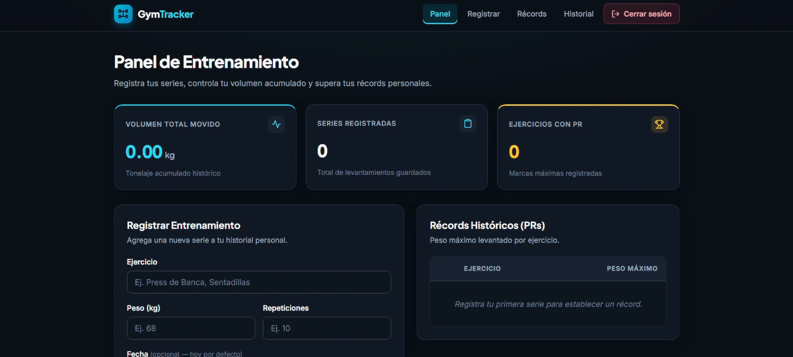
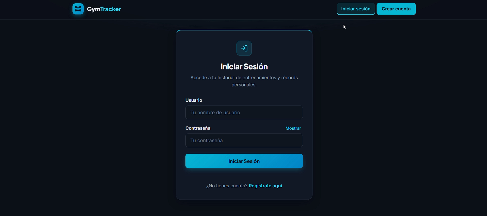

# 🏋️ Gym Tracker


A full-stack web application for tracking strength training workouts, calculating cumulative lifting volume, and automatically monitoring personal records (PRs) per user.

Developed as a **CS50 Final Project**, this application focuses on clean server-side rendering, secure user authentication, and relational data persistence with SQLite3.

---

## ✨ Key Features

- **User Authentication & Session Management:** Secure registration (`/register`), login (`/login`), and logout (`/logout`) flows using Flask cookie-based sessions (`SECRET_KEY`) and password hashing via `werkzeug.security` (`generate_password_hash` and `check_password_hash`).
- **Strict User Data Isolation:** All database queries and mutations are scoped to `session["user_id"]`, ensuring users can only view, log, and delete their own workout records.
- **Workout Set Logging:** Log exercises with weight (kg, decimal precision supported), repetitions, and an optional date (automatically defaults to the current date if left blank).
- **Automated Progress Analytics:**
  - **Total Volume Lifted:** Dynamically computes cumulative tonnage in kilograms (`SUM(peso * repeticiones)`).
  - **Personal Records (PRs):** Aggregates and displays the maximum weight lifted (`MAX(peso)`) for each exercise.
- **Workout History Management:** Displays all logged sets in reverse chronological order (`fecha DESC, id DESC`) with per-row deletion protected by a client-side confirmation prompt and server-side ownership validation.
- **Dark Mode UI:** Clean, responsive dark-themed interface built with custom CSS3 Flexbox layouts.

---

## 🛠️ Tech Stack

- **Backend:** Python 3, Flask
- **Database:** SQLite3 (via the `cs50` SQL library)
- **Templating:** Jinja2
- **Security:** Werkzeug (`generate_password_hash`, `check_password_hash`)
- **Frontend:** HTML5, CSS3

---

## 🏗️ Project Architecture & Directory Structure

```text
tracker-gym/
├── static/
│   └── styles.css          # Dark-mode styling, Flexbox layout, and table/card components
├── templates/
│   ├── index.html          # Main dashboard: workout form, stats, PRs, and history table
│   ├── login.html          # User login form
│   └── register.html       # User registration form with password confirmation
├── .gitignore              # Ignores local SQLite database (gym.db) and Python cache files
├── app.py                  # Flask application, authentication routes, and tracker endpoints
├── crear_db.py             # SQLite3 database initialization script
└── README.md               # Project documentation
```

### Database Schema (`gym.db`)

The SQLite3 database consists of two relational tables linked by a foreign key:

| Table | Columns | Description |
| :--- | :--- | :--- |
| `usuarios` | `id` (PK), `usuario` (UNIQUE), `hash` | Stores registered usernames and salted password hashes. |
| `entrenamientos` | `id` (PK), `usuario_id` (FK), `ejercicio`, `peso`, `repeticiones`, `fecha` | Stores individual workout sets linked to `usuarios(id)`. |

### Application Routes (`app.py`)

| Method | Route | Description |
| :--- | :--- | :--- |
| `GET` / `POST` | `/register` | Validates form inputs, hashes password, creates user, and starts session. |
| `GET` / `POST` | `/login` | Authenticates user credentials and stores `user_id` in session. |
| `GET` | `/logout` | Clears the active session and redirects to `/login`. |
| `GET` | `/` | Renders the dashboard with workout history, PRs, and total volume. |
| `POST` | `/registrar` | Inserts a new workout set for the authenticated user. |
| `POST` | `/eliminar` | Deletes a specific workout set owned by the authenticated user. |

---

## ⚙️ Installation & Local Setup

Follow these steps to run the project locally:

### 1. Clone the repository

```bash
git clone https://github.com/mgc-cloud17/tracker-gym.git
cd tracker-gym
```

### 2. Create and activate a virtual environment

**macOS / Linux:**
```bash
python3 -m venv venv
source venv/bin/activate
```

**Windows (PowerShell):**
```powershell
python -m venv venv
.\venv\Scripts\Activate.ps1
```

### 3. Install dependencies

```bash
pip install -r requirements.txt
```

### 4. Run the application

```bash
python app.py
```

*(Alternatively, you can run `python -m flask run`.)*

> **Note:** The SQLite3 database (`gym.db`) is automatically initialized from `schema.sql` on first startup—no manual setup required.

Open your browser and navigate to `http://127.0.0.1:5000`.

---

## 📸 Screenshots

> Place your screenshot files inside an `./assets/` directory at the root of the repository to display them below.

| Dashboard & Progress Stats | User Authentication |
| :---: | :---: |
|  |  |
